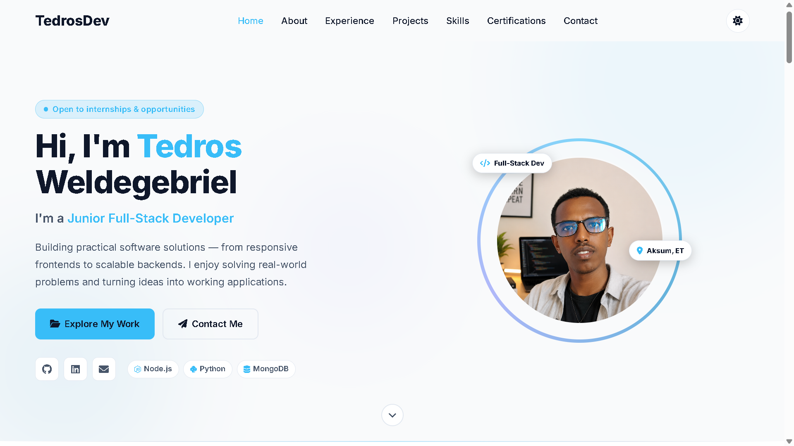
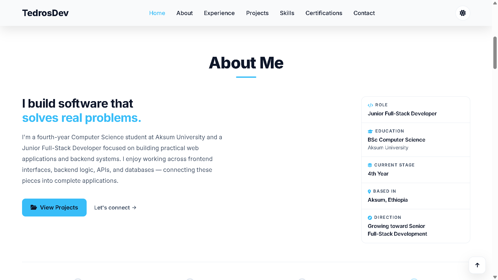
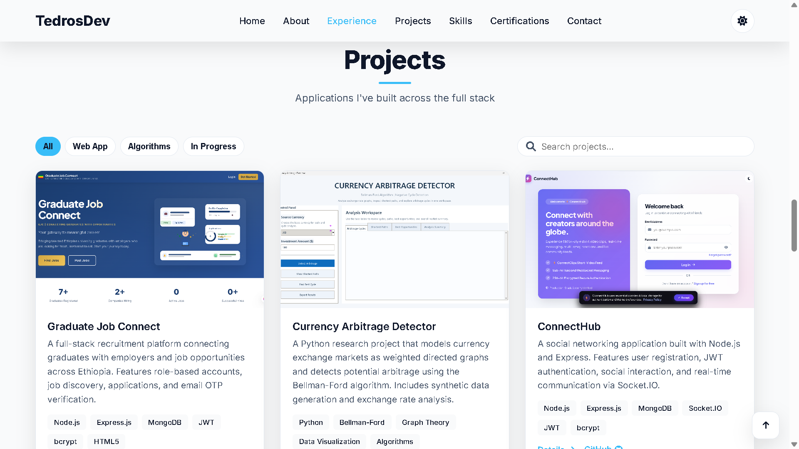
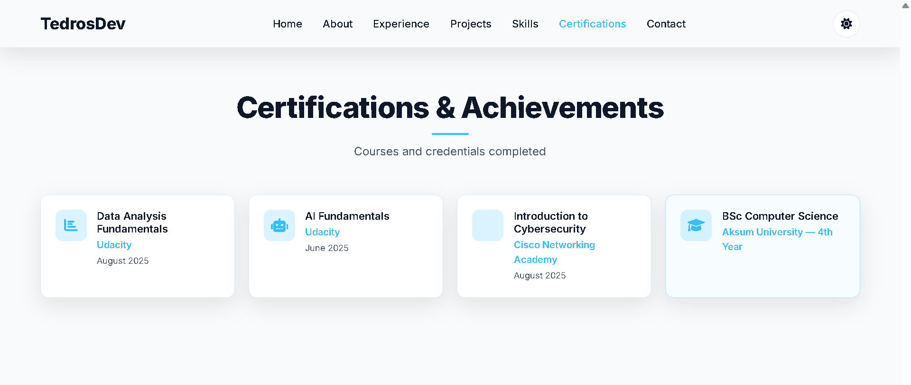

# Tedros Weldegebriel — Developer Portfolio

A personal developer portfolio built with **HTML**, **CSS**, and **vanilla JavaScript**. Designed to be responsive, accessible, and consistent across light and dark themes.

Live site: [tedrosdev.netlify.app](https://tedrosdev.netlify.app)

---

## 📸 Screenshots

### Hero



### About Me



### Experience & Education


### Projects



### Technical Skills


### Certifications & Achievements



### Get In Touch


---

## 🚀 Run Locally

Clone the repository and open `index.html` directly in a browser, or use a local development server:

```bash
# With VS Code Live Server, or:
npx serve .
```

No build step required.

---

## 📂 Project Structure

```
My portfolio/
├── screenshots/          # Section screenshots for README
├── data/
│   ├── projects.json     # Project data loaded at runtime
│   ├── Graduate Job Connect/
│   ├── connecthub/
│   ├── currency arbitrage/
│   ├── image samples GPS/
│   ├── image samples IMS/
│   └── AI Learning Tutor (In Progress)/
├── tools/
│   └── update_projects.py  # Python script to sync projects from GitHub
├── index.html
├── style.css
├── script.js
├── sitemap.xml
├── robots.txt
├── netlify.toml
└── README.md
```

---

## 🛠 Tech Stack

| Layer        | Technologies                                        |
|--------------|-----------------------------------------------------|
| Frontend     | HTML5, CSS3, JavaScript (ES6+)                      |
| Styling      | CSS custom properties, Grid, Flexbox, transitions   |
| Fonts        | Inter (Google Fonts)                                |
| Icons        | Font Awesome 6                                      |
| Deployment   | Netlify (with form handling)                        |
| Tooling      | Python (project data sync script)                   |
| Version ctrl | Git & GitHub                                        |

---

## ✨ Features

- **Animated hero** — typing role effect, spinning gradient ring around photo, floating accent chips, scroll hint
- **About section** — two-column intro with developer profile panel, horizontal journey timeline, focus areas grid, philosophy quote
- **Experience & Education** — polished two-column card layout with accent stripes, status badges, and skill tags
- **Projects** — loaded from `data/projects.json`, with category filters, keyword search, and a details modal with gallery screenshots
- **Skills** — grouped tag clouds across 5 categories (Frontend, Backend, Databases, CS & Algorithms, Developer Tools)
- **Certifications** — Udacity and Cisco credentials
- **Contact** — Netlify form with honeypot spam protection
- **Light / dark theme** — persisted to `localStorage`
- **Scroll reveal animations** — IntersectionObserver, respects `prefers-reduced-motion`
- **Fully responsive** — breakpoints at 900px, 768px, 480px

---

## 🗂 Projects Featured

| Project | Stack | Link |
|---------|-------|------|
| Graduate Job Connect | Node.js, Express, MongoDB, JWT | [GitHub](https://github.com/tedrosweldegebriel465-eng/Graduate-Job-Connect-GJC-) |
| Currency Arbitrage Detector | Python, Bellman-Ford, Graph Theory | [GitHub](https://github.com/tedrosweldegebriel465-eng/currency-arbitrage) |
| ConnectHub | Node.js, MongoDB, Socket.IO | [GitHub](https://github.com/tedrosweldegebriel465-eng/ConnectHub) |
| Ethiopian GPS Navigation | Python, Flask, NetworkX, Folium | [GitHub](https://github.com/tedrosweldegebriel465-eng/ethiopian-gps-navigation-system) |
| MerkatoStock (IMS) | PHP, MySQL, Bootstrap | [GitHub](https://github.com/tedrosweldegebriel465-eng/ims-inventory-management-system) |
| AI Learning Tutor | In Progress | — |

---

## 📬 Contact

**Tedros Weldegebriel** — Junior Full-Stack Developer · Aksum University, Ethiopia

- GitHub: [tedrosweldegebriel465-eng](https://github.com/tedrosweldegebriel465-eng)
- LinkedIn: [tedros-dev369](https://www.linkedin.com/in/tedros-dev369/)
- Email: [tedrosweldegebriel465@gmail.com](mailto:tedrosweldegebriel465@gmail.com)
